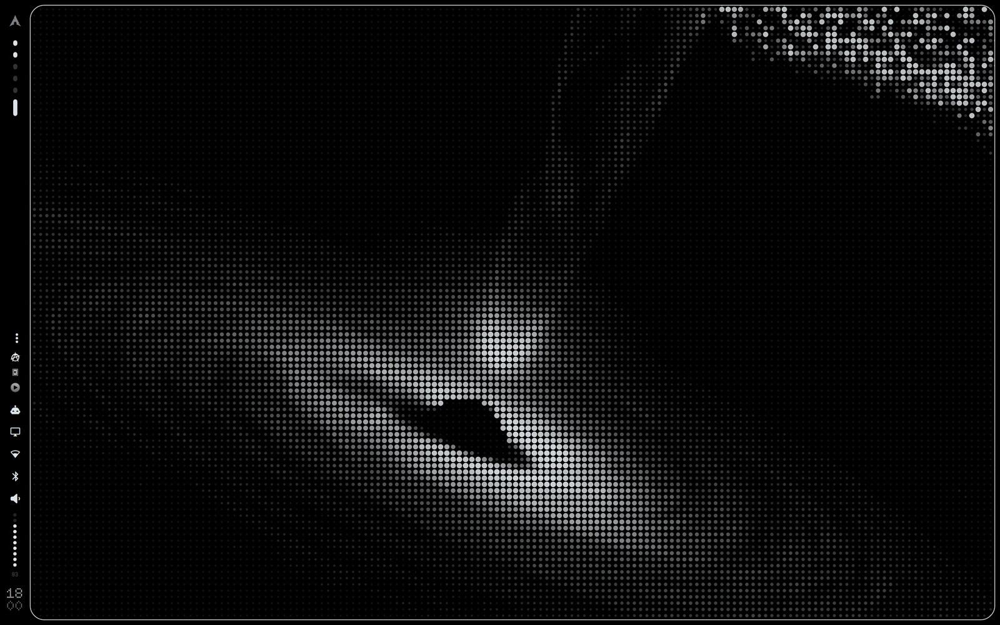

# Omarchy DOT-MATRIX Tray

[🇷🇺 Русский](README.ru.md)

System tray: Omarchy menus, monochrome icons, no drawer by default — the stock [Omarchy](https://omarchy.org) bar widget (`omarchy.tray`) redrawn in the **DOT-MATRIX** style:
Nothing-OS-like dot-matrix type, flat cards with hairline borders and a palette that follows your Omarchy theme
(or the original black / white / red).

Part of a family of DOT-MATRIX plugins: [bar skins](https://github.com/KamradSmeshnyavy/omarchy-bar-skins), [Customizer](https://github.com/KamradSmeshnyavy/omarchy-customizer) and the
[other DOT-MATRIX panels](https://github.com/KamradSmeshnyavy?tab=repositories&q=omarchy-dotmatrix).



<!-- Demo video: repo-videos/omarchy-dotmatrix-tray.mp4 — drag it here when editing this file on GitHub -->

## Install

```sh
omarchy plugin add https://github.com/KamradSmeshnyavy/omarchy-dotmatrix-tray --enable
omarchy restart shell
```

`--enable` asks which bar section the widget goes into. Remove the stock `omarchy.tray` widget from the bar if you
don't want both.

## Requirements

Omarchy 4 (Quattro) with its shell. Tested on Omarchy 4.0.6 with Quickshell 0.3.2.

- Nothing beyond Omarchy — the panel uses the same services as the stock one.
- Fonts: the DOT-MATRIX fonts (Doto, Space Grotesk, Space Mono) ship with the [Customizer](https://github.com/KamradSmeshnyavy/omarchy-customizer); without them
  the panel falls back to the Omarchy font.

## Uninstall

```sh
omarchy plugin remove kamradsmeshnyavy.tray
omarchy restart shell
```

Put the stock `omarchy.tray` widget back into the bar from the bar settings if you removed it.

## Settings

The palette is shared by every DOT-MATRIX plugin: `~/.config/omarchy/dotmatrix.json`
(`{"palette": "theme"}` — colours from the current theme, default; `{"palette": "mono"}` — the original Nothing
look). Every role can be overridden there, or in [Customizer](https://github.com/KamradSmeshnyavy/omarchy-customizer) → Widgets → DOT-MATRIX palette.

## License

MIT — see [LICENSE](LICENSE) and [NOTICE](NOTICE). Based on Omarchy's own `omarchy.tray` plugin (MIT).

Part of [my dotfiles](https://github.com/KamradSmeshnyavy/dotfiles).
